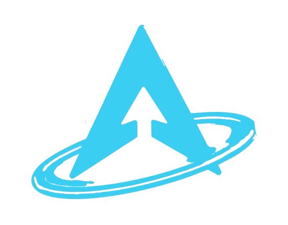
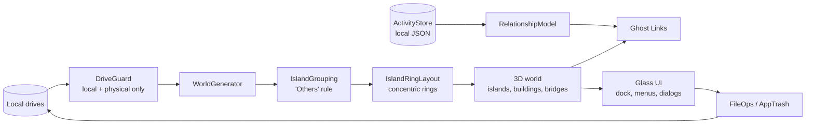

<div align="center">


<!--  -->

# ATLAS

**A 3D file explorer for Windows where your folders are floating islands.**

Built with Godot 4.7 (.NET) and C#.

[](https://github.com/neogurpreet-dev/HCAK26/actions/workflows/build-atlas-windows.yml)


</div>

---

## What is ATLAS?

- Instead of a list of rows, ATLAS turns the current folder into a **3D world**.
- Every file and sub-folder is a **building**. Buildings are grouped into **floating islands** by file type.
- Islands are linked by **neon skybridges** and arranged in **concentric rings** around a central hub.
- It still does the normal file-explorer jobs: navigate, preview, rename, copy, move, delete, create.

## Download and run

1. Open the [**Releases**](../../releases) page.
2. Download `ATLAS-windows-x64.zip`.
3. Unzip it. Keep every file together in the same folder.
4. Run `ATLAS.exe`.

Notes:

- Nothing else needs to be installed.
- Windows may show a **SmartScreen** warning because the app is not code-signed. Choose **More info > Run anyway**.

## Features

### The world

- **Hub + satellite islands**: the hub holds the most relevant items, satellites hold the rest by category.
- **"Others" rule**: a category with 3 or more items gets its own island. Smaller categories are folded into one **Others** island, so nothing is lost.
- **Property mapping**: building size, height and look can be driven by file properties (such as size or usage). Presets update the world live.
- **Overflow beacon**: folders with more than 100 items show a "+ N more" beacon instead of flooding the scene.
- **Live updates**: creating or deleting files in the current folder refreshes the view automatically.

### Navigating and previewing

- Left dock with Back, Forward, Parent, Home, Reset camera, Refresh, View filter and Settings.
- Hover a building for a name label and a **safe, bounded preview**:
  - Text and code: first 4 KB only, with light syntax colouring.
  - Images: PNG, JPG, WebP, BMP, TGA and SVG up to 12 MB, shown as a thumbnail.
  - Nothing is ever executed or opened through the shell just to preview it.
- Selected buildings lift up so they are easy to see.

### File operations

- Glass **context menus** for a building, empty space, or a multi-selection.
- Rename, copy, cut, paste, create new (Folder, Shortcut, TXT, MD, DOCX, PPTX, XLSX, ZIP, BMP) and **Open with**.
- **Reversible delete**: items go to an ATLAS trash and can be restored with **Ctrl+Z**. "Delete permanently" asks for confirmation.

### Ghost Links

- Select a building and a platform rises above it showing the files and apps **most often used together** with it.
- Built from a local, recency-weighted relationship model over your usage sessions.
- Activity tracking is local only. File contents, window titles and keystrokes are never stored.
- Observing app activation outside ATLAS is opt-in.

### Safety

- **Drive guard**: only fixed and removable local drives are listed. Network drives, optical drives and UNC paths are refused.
- Junctions, symlinks and cloud placeholders (OneDrive, Dropbox, Google Drive) are skipped, so ATLAS never triggers a cloud download.

## Controls

| Action | Input |
| --- | --- |
| Orbit | Left-drag |
| Pan | Ctrl + left-drag, middle-drag, or arrow keys |
| Zoom | Mouse wheel (zooms toward the cursor) |
| Rotate | `Q` / `E` |
| Reset camera | `Home` |
| Select | Click (Ctrl+click for multi-select, `Ctrl+A` for all) |
| Open | Double-click |
| Up one folder | `Backspace` |
| Back / Forward | `Alt+Left` / `Alt+Right` |
| Refresh | `F5` |
| Context menu | Right-click, or `Shift+F10` / Menu key |
| Rename | `F2` |
| Delete (reversible) | `Del` |
| Delete permanently | `Shift+Del` |
| Copy / Cut / Paste | `Ctrl+C` / `Ctrl+X` / `Ctrl+V` |
| Undo delete | `Ctrl+Z` |

## How it fits together



## Build it yourself

**Requirements**

- [Godot 4.7.2 **.NET** edition](https://godotengine.org/download)
- [.NET 8 SDK](https://dotnet.microsoft.com/download/dotnet/8.0)
- Windows 10 or 11

**Steps**

1. Clone the repo:
   ```bash
   git clone https://github.com/neogurpreet-dev/HCAK26.git
   cd HCAK26
   ```
2. Open `ATLAS/project.godot` in Godot.
3. Press the **Build** (hammer) button, then **F5** to run.
4. To export: **Project > Export > Windows Desktop**.

> Optional: pass a start folder after `--`, for example `-- C:\path\to\folder`.

## Releases and CI

- Builds run through GitHub Actions: [`build-atlas-windows.yml`](.github/workflows/build-atlas-windows.yml).
- Push to `atlas` or `main`: the zip is attached to the workflow run as an artifact.
- Push a tag like `v0.1.3`: the zip is also published as a GitHub Release.
- You can also trigger a build manually from the **Actions** tab.

```bash
git tag v0.1.3
git push origin v0.1.3
```

## Repo layout

```
HCAK26/
├── ATLAS/                  # the app (Godot .NET project)
│   ├── Assets/             # logo, UI icons, environment models
│   ├── Scenes/             # MainWorld, FileBuilding, FloatingPlatform, Bridge
│   ├── Scripts/
│   │   ├── Activity/       # local activity store + relationship model
│   │   ├── Core/           # FsEntry, FileCategory
│   │   ├── Services/       # file ops, trash, drive guard, previews, shell helpers
│   │   ├── UI/             # glass theme, dock, menus, dialogs, panels
│   │   └── World/          # generator, layout, camera, interaction, Ghost Links
│   └── Shaders/            # frosted glass shader
├── ClashFileExplorer/      # earlier prototype of the idea
└── .github/workflows/      # Windows build + release pipeline
```

## Status

- Early releases (`v0.1.x`). Expect rough edges.
- Not yet implemented: tabs, drag-and-drop, favorites, sort/group controls, and Replace/Skip prompts on name clashes (clashes get a "- Copy" name).
- Windows only.

## Contributing

- Found a bug or have an idea? [Open an issue](https://github.com/neogurpreet-dev/HCAK26/issues).
- Pull requests are welcome. Please keep changes focused and build cleanly before submitting.

## Author

Made by **NeoGurpreet** ([@neogurpreet-dev](https://github.com/neogurpreet-dev)).
